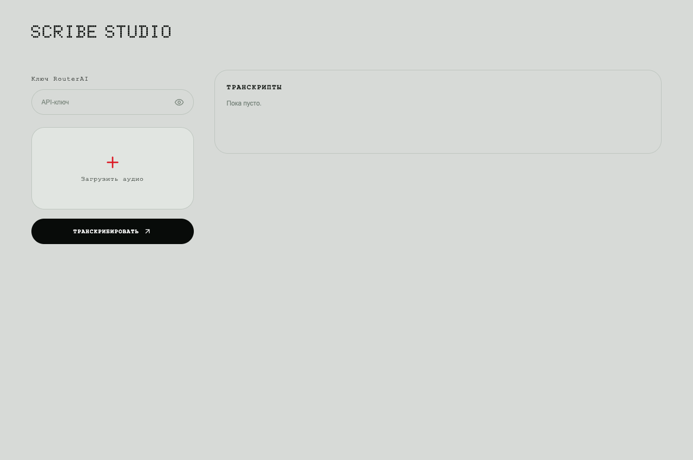

# Scribe Studio

Минималистичный **статический сайт** для транскрибации аудио через
[ElevenLabs Scribe v2 в RouterAI](https://routerai.ru/models/elevenlabs/scribe-v2).
Всё выполняется в браузере: чтение файла, нарезка, запросы API и сохранение результатов.

**[Открыть scribe.sh1sha.ru](https://scribe.sh1sha.ru)**



## Использование

1. Вставьте свой API-ключ RouterAI.
2. Выберите или перетащите аудио. Можно несколько файлов.
3. Нажмите **«Транскрибировать»** и держите вкладку открытой.
4. Откройте транскрипт, скопируйте текст или скачайте TXT, JSON, SRT либо ZIP.

Ключ сохраняется в локальном хранилище IndexedDB этого браузера и подставляется
после перезагрузки. Чтобы удалить сохранённый ключ, очистите поле.
Он не вшит в сайт, не попадает в URL, репозиторий или экспорт.
Сервис использует ваш баланс RouterAI;
фактическая стоимость берётся из `usage.cost` ответа API в рублях.

## Большие записи

- Исходник читается частями через `BlobSource`, с ограниченным кешем 8 МиБ.
- Браузерный Web Worker декодирует только нужный временной диапазон.
- Запись разбивается на самостоятельные WAV: моно, 16 кГц, 16 бит, по 10 минут.
  Каждый запрос содержит менее 20 МиБ аудио — ниже лимита прокси 25 МБ.
- Две секунды перекрытия дают контекст на стыках. При наличии таймкодов
  слова распределяются по середине перекрытия, а время переводится в общую шкалу.
- Уже готовые части повторно не отправляются. Временный WAV удаляется после
  надёжного сохранения ответа.
- Нет прикладного ограничения на размер исходника. Реальные границы —
  возможности браузера и кодека, свободное место и баланс API.

Поддерживаются WAV/RF64, MP3, M4A/AAC, FLAC, Ogg, WebM и аудиодорожки видео
в форматах, которые может декодировать ваш браузер.
Рекомендуется актуальный Chrome или Edge. Доступность отдельных кодеков
зависит от браузера и операционной системы; неподдерживаемый файл не отправляется в API.

## Сохранение и продолжение

История, исходные ответы API и текст сохраняются в **IndexedDB**,
подготовленный аудиофрагмент — в **OPFS** (или IndexedDB, если OPFS недоступна).
Регистрации, сервера и облачного хранилища нет.

После обновления страницы ключ восстанавливается автоматически. Если исходник ещё нужен,
выберите тот же файл и нажмите **«Продолжить»**. Для проверки соответствия
используются размер и SHA-256 начала/конца файла. Готовые ответы сохраняются.
После перезагрузки для воспроизведения аудио нужно повторно выбрать исходник.

Если вкладка закрылась во время API-запроса, его исход может быть неизвестен.
Приложение **не повторяет такой запрос автоматически**: сначала проверьте расход
в RouterAI и отдельно подтвердите повтор. Это защищает от скрытого двойного списания.
Web Locks не позволяют двум вкладкам одновременно отправлять задачи.

Данные принадлежат конкретному браузеру и origin. Очистка данных сайта,
приватный режим, смена домена или устройства могут удалить либо скрыть историю.
Для долгого хранения скачивайте результаты. Переход с `github.io` на собственный
домен не переносит IndexedDB автоматически.

## Что содержат результаты

- **TXT** — обычный текст.
- **Таймкоды** — текст с общим временем и метками говорящих, если они получены.
- **JSON** — исходные ответы по частям, их смещения и собранные реплики.
- **SRT** — субтитры; доступны только если API вернул временные метки.
- **ZIP** — все доступные форматы одним архивом.

Метки говорящих определяются автоматически и действуют **внутри части записи**.
Одинаковый номер в разных API-запросах не гарантирует одного человека.
Если прокси не возвращает таймкоды, сохраняется обычный текст; на стыках удаляются
только точно совпадающие фразы, а время показывает начало аудиочасти.
Автоматическая транскрибация может содержать ошибки — важные места проверяйте по аудио.

## Локальный запуск

Готовая страница находится в `dist/`. Node.js для её работы не нужен:

```sh
python3 -m http.server 8790 --directory dist
```

Откройте http://localhost:8790. Это только статическая раздача файлов,
без серверной обработки аудио. В интернете используйте HTTPS — он нужен
для браузерных API. Открытие `index.html` через `file://` не поддерживается.

## Разработка

Нужен Node.js 22+.

```sh
npm ci --ignore-scripts
npm run vendor
npm test
npm run preview
```

Зависимости зафиксированы в `package-lock.json`. Их браузерные сборки,
шрифт, иконки [Lucide](https://lucide.dev/) и лицензии находятся в `dist/vendor/`, поэтому во время работы
не загружаются JavaScript, шрифты или WebAssembly с внешних CDN.

```text
dist/
  index.html / styles.css / theme.css  интерфейс
  app.js                              взаимодействие и история
  worker.js                           очередь и вызовы RouterAI
  audio.js                            чтение и нарезка аудио
  db.js                               IndexedDB и OPFS
  core.js                             таймкоды, сборка, экспорт
  vendor/                             зависимости и лицензии
scripts/vendor.mjs                     обновление браузерных сборок
tests/core.test.mjs                    проверки обработки и сборки
.github/workflows/                    CI и GitHub Pages
```

## Публикация на GitHub Pages

В репозитории включите **Settings → Pages → Source: GitHub Actions**.
Workflow проверяет проект и публикует только `dist/`.
Для другого репозитория или домена серверная настройка не требуется:
все пути к ресурсам относительные. Собственный домен задаётся в настройках Pages.

Приложение отправляет запросы прямо на
`https://routerai.ru/api/v1/audio/transcriptions`, модель `elevenlabs/scribe-v2`.
Аудио и ключ передаются RouterAI для обработки; GitHub Pages их не получает.
Аналитики, рекламных трекеров и cookies в приложении нет.

## Лицензии

Код приложения — [MIT](LICENSE). Зависимости сохраняют собственные лицензии;
подробности в [THIRD_PARTY.md](THIRD_PARTY.md).
